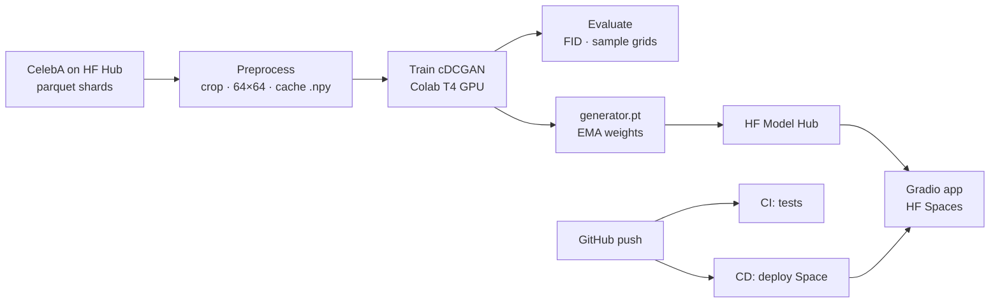

# FaceForge: Conditional GAN Face Generator

[](https://github.com/Naman-verma-02/faceforge-gan/actions/workflows/ci.yml)
[](https://colab.research.google.com/github/Naman-verma-02/faceforge-gan/blob/main/notebooks/train_colab.ipynb)
[](https://huggingface.co/spaces/e-NV-y/faceforge-gan)


An end-to-end deep learning project: a **conditional Deep Convolutional GAN** trained on
**CelebA** generates 64×64 faces that you can steer with six attributes
(**male, smiling, eyeglasses, blond hair, black hair, young**). It is trained on a cloud GPU,
the weights are published to the Hugging Face Hub, and a live Gradio app serves it on
Hugging Face Spaces, deployed automatically by GitHub Actions.

**Live demo:** https://huggingface.co/spaces/e-NV-y/faceforge-gan

---

## Pipeline



## Model

```mermaid
flowchart TB
    subgraph Generator
      z["z ~ N(0, I) (128)"] --> cat((concat))
      y1["attributes y (6)"] --> emb[Linear + LeakyReLU → 64] --> cat
      cat --> t1["ConvT 4×4 → 512×4×4"] --> t2["ConvT → 256×8×8"] --> t3["ConvT → 128×16×16"] --> t4["ConvT → 64×32×32"] --> t5["ConvT → 3×64×64, tanh"]
    end
    subgraph Discriminator
      x["image 3×64×64"] --> c1["SN-Conv → 64×32×32"] --> c2["SN-Conv → 128×16×16"] --> c3["SN-Conv → 256×8×8"] --> c4["SN-Conv → 512×4×4"] --> phi["φ(x) flatten"]
      phi --> lin["SN-Linear → ψ(φ)"]
      y2["attributes y"] --> proj["SN-Linear embed(y)"]
      phi --> dot((inner product))
      proj --> dot
      lin --> sum((+))
      dot --> sum --> logit[real/fake logit]
    end
```



| Component | Choice | Why |
|---|---|---|
| Backbone | DCGAN (Radford et al., 2015) | Strided (transposed) convs, BatchNorm in G, proven on faces |
| G conditioning | Learned embedding of y, concatenated with z | Lets G map attribute combinations, not just one-hot classes |
| D conditioning | **Projection discriminator** (Miyato & Koyama, 2018) | D checks image–attribute agreement; more stable than concatenating label maps |
| Stabilisation | **Spectral normalisation** in D | Bounds D's Lipschitz constant, prevents exploding gradients and mode collapse |
| Loss | **Hinge loss** (BCE with one-sided label smoothing also available) | Standard pairing with SN + projection |
| Inference weights | **EMA** of G (decay 0.999) | Averages out GAN oscillation; noticeably cleaner samples |
| Label sampling | G gets attribute vectors shuffled from the real batch | Learns realistic combinations (no "bald + blond") |
| Speed | Mixed precision (AMP), cached uint8 dataset | Full run fits in one Colab T4 session |

Generator: ~4.3M parameters · Discriminator: ~2.8M parameters.

## Results

> Filled in after training. Run the Colab notebook, then copy `curves.png`, `showcase.png` and
> `morph.png` from the run folder into `assets/` and uncomment the images below.

| Metric | Value |
|---|---|
| Training images | ~51k (6 CelebA shards) |
| Epochs | 25 |
| FID (10k samples, lower is better) | _fill in_ |

<!--


-->

## Demo features

* **Generate:** choose attributes, a seed and a truncation value; get up to 16 faces.
* **Attribute sweep:** the same face (fixed z) with each attribute switched on in turn, showing that
  the model has disentangled identity from attributes.
* **Morph:** spherical interpolation between two seeds while blending their attribute vectors.

## Project structure

```
faceforge-gan/
├── faceforge/
│   ├── config.py        # all hyper-parameters in one dataclass
│   ├── data.py          # CelebA download, crop/resize, .npy cache, Dataset
│   ├── models.py        # Generator, projection Discriminator, EMA
│   ├── train.py         # training loop (AMP, hinge/BCE, checkpoints, resume)
│   ├── evaluate.py      # FID with torchmetrics
│   ├── inference.py     # load model, generate, slerp interpolation
│   └── hub.py           # publish weights + model card to Hugging Face
├── app.py               # Gradio demo (Spaces / local / Docker)
├── notebooks/train_colab.ipynb
├── space/               # Space metadata + slim requirements
├── tests/               # unit tests + end-to-end training smoke test
├── .github/workflows/   # ci.yml (tests) · deploy-space.yml (CD to Spaces)
└── Dockerfile
```

## Run it yourself

### 1. Train (Colab, recommended)
Open the notebook with the badge above, choose a **T4 GPU** runtime and run all cells. It downloads
CelebA, trains, plots results and pushes the model to Hugging Face.

### 2. Train (any machine with a GPU)
```bash
git clone https://github.com/Naman-verma-02/faceforge-gan.git && cd faceforge-gan
pip install -r requirements.txt
python -m faceforge.train --epochs 25 --num-shards 6       # writes runs/faceforge/
python -m faceforge.evaluate --checkpoint runs/faceforge/generator.pt
huggingface-cli login
python -m faceforge.hub --repo <hf-username>/faceforge-gan
```
Every `Config` field is a CLI flag (`--z-dim`, `--lr-d`, `--batch-size`, ...). Resume with
`--resume runs/faceforge/last.pt`.

### 3. Run the demo locally
```bash
FACEFORGE_MODEL=runs/faceforge/generator.pt python app.py     # or a HF repo id
# or with Docker
docker build -t faceforge . && docker run -p 7860:7860 faceforge
```

### 4. Deploy to Hugging Face Spaces (automatic)
In GitHub: **Settings → Secrets and variables → Actions**
* secret `HF_TOKEN`: a Hugging Face **write** token
* variable `HF_SPACE`: `<hf-username>/faceforge-gan`

Every push to `main` that touches the app or model code redeploys the Space
(or run the *Deploy to Hugging Face Space* workflow manually).

### Tests
```bash
pip install -r requirements-dev.txt
pytest -q          # model shapes, conditioning, EMA, slerp, train → export → reload
```

## Limitations
* 64×64 resolution: a DCGAN-scale model; StyleGAN-class models are needed for high-resolution faces.
* CelebA is a celebrity dataset with known demographic imbalance, which the generator inherits.
* Attributes that are rare in the data (e.g. eyeglasses, ~6.5%) are learned less reliably.

## References
1. Radford, Metz, Chintala. *Unsupervised Representation Learning with Deep Convolutional GANs.* ICLR 2016.
2. Mirza, Osindero. *Conditional Generative Adversarial Nets.* 2014.
3. Miyato, Kataoka, Koyama, Yoshida. *Spectral Normalization for GANs.* ICLR 2018.
4. Miyato, Koyama. *cGANs with Projection Discriminator.* ICLR 2018.
5. Heusel et al. *GANs Trained by a Two Time-Scale Update Rule Converge to a Local Nash Equilibrium* (FID). NeurIPS 2017.
6. Liu, Luo, Wang, Tang. *Deep Learning Face Attributes in the Wild* (CelebA). ICCV 2015.

---
Made by **Naman Verma** (B.Tech CSE, KIET Ghaziabad) as a Deep Learning project.
