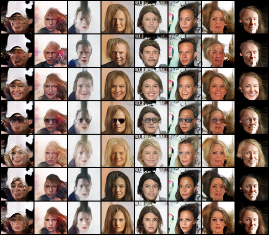
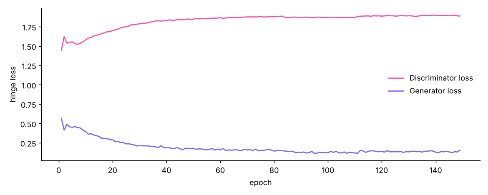
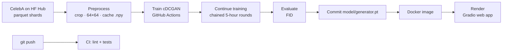

# FaceForge: Conditional GAN Face Generator

[](https://github.com/NAMAN-VERMA-02/faceforge-gan/actions/workflows/ci.yml)
[](https://faceforge-gan.onrender.com)
[](https://colab.research.google.com/github/NAMAN-VERMA-02/faceforge-gan/blob/main/notebooks/train_colab.ipynb)


An end-to-end deep learning project: a **conditional Deep Convolutional GAN** trained on
**CelebA** generates 64×64 faces that you can steer with six attributes
(**male, smiling, eyeglasses, blond hair, black hair, young**). The model is trained in the
cloud by GitHub Actions, evaluated with FID, and served as a live Gradio web app on Render.

**Live demo:** https://faceforge-gan.onrender.com
(free tier: the first visit after a quiet period takes about a minute to wake up)



*Each column is one fixed noise vector z, so it shows the same "person". Each row switches on one
attribute: none, male, smiling, eyeglasses, blond hair, black hair, young. Identity stays put
while the requested attribute changes, which shows the model has separated the two.*

---

## Results

| Metric | Value |
|---|---|
| **FID** (3,000 samples, lower is better) | **25.58** |
| Training images | ~34,000 CelebA faces (4 parquet shards) |
| Training | 149 epochs, ~15 hours on GitHub Actions CPU runners (4 chained runs) |
| Generator / Discriminator size | ~4.3M / ~2.8M parameters |

FID went down as training continued: **28.95 → 25.58** between the last two rounds.
For a 64×64 DCGAN-sized model, 15–40 is the usual range, so this is a solid result for CPU-only training.



The discriminator and generator losses settle into a stable equilibrium with no collapse or
oscillation, which is what spectral normalisation, TTUR and DiffAugment are there to achieve.

## Pipeline



GitHub's free runners stop a job after 6 hours, so training runs in rounds: each round resumes
from the previous round's checkpoint (`last.pt`, kept as a workflow artifact), trains for 5 hours,
measures FID, commits the improved generator and starts the next round automatically.

## Model

```mermaid
flowchart TB
    subgraph Generator
      z["z ~ N(0, I) (128)"] --> cat((concat))
      y1["attributes y (6)"] --> emb[Linear + LeakyReLU → 64] --> cat
      cat --> t1["ConvT 4×4 → 512×4×4"] --> t2["ConvT → 256×8×8"] --> t3["ConvT → 128×16×16"] --> t4["ConvT → 64×32×32"] --> t5["ConvT → 3×64×64, tanh"]
    end
    subgraph Discriminator
      x["image 3×64×64"] --> aug["DiffAugment"] --> c1["SN-Conv → 64×32×32"] --> c2["SN-Conv → 128×16×16"] --> c3["SN-Conv → 256×8×8"] --> c4["SN-Conv → 512×4×4"] --> phi["φ(x) flatten"]
      phi --> lin["SN-Linear → ψ(φ)"]
      y2["attributes y"] --> proj["SN-Linear embed(y)"]
      phi --> dot((inner product))
      proj --> dot
      lin --> sum((+))
      dot --> sum --> logit[real/fake logit]
    end
```



| Component | Choice | Why |
|---|---|---|
| Backbone | DCGAN (Radford et al., 2015) | Strided (transposed) convs, BatchNorm in G, proven on faces |
| G conditioning | Learned embedding of y, concatenated with z | Lets G map attribute combinations, not just one-hot classes |
| D conditioning | **Projection discriminator** (Miyato & Koyama, 2018) | D checks image–attribute agreement; more stable than concatenating label maps |
| Stabilisation | **Spectral normalisation** in D | Bounds D's Lipschitz constant, prevents exploding gradients and mode collapse |
| Data efficiency | **DiffAugment** (Zhao et al., 2020): colour, translation, cutout | Same random augmentation on real and fake images, so D can't memorise a small dataset |
| Learning rates | **TTUR**: G 1e-4, D 4e-4, Adam β = (0, 0.999) | D learns faster than G, giving a stable equilibrium (Heusel et al., 2017) |
| Loss | **Hinge loss** (BCE with one-sided label smoothing also available) | Standard pairing with SN + projection |
| Inference weights | **EMA** of G (decay 0.999) with **warm-up** | Averages out GAN oscillation; warm-up stops early random weights lingering |
| Label sampling | G gets attribute vectors shuffled from the real batch | Learns realistic combinations (no "bald + blond") |

### What changed the quality most
A first 25-minute run (no DiffAugment, equal learning rates) produced blurry, orange-tinted faces.
Adding **DiffAugment, TTUR and EMA warm-up**, plus more data and training time, produced the
results above. Both are kept for comparison: [`quick_samples_latest.png`](assets/quick_samples_latest.png)
vs [`final_samples.png`](assets/final_samples.png).

## Demo features

* **Generate:** choose attributes, a seed and a truncation value; get up to 16 faces.
* **Attribute sweep:** the same face (fixed z) with each attribute switched on in turn.
* **Morph:** spherical interpolation (slerp) between two seeds while blending their attribute vectors.

## Project structure

```
faceforge-gan/
├── faceforge/
│   ├── config.py        # all hyper-parameters in one dataclass
│   ├── data.py          # CelebA download, crop/resize, .npy cache, Dataset
│   ├── models.py        # Generator, projection Discriminator, EMA
│   ├── augment.py       # DiffAugment (colour, translation, cutout)
│   ├── train.py         # training loop (AMP, hinge/BCE, checkpoints, resume, time budget)
│   ├── evaluate.py      # FID with torchmetrics
│   ├── inference.py     # load model, generate, slerp interpolation
│   └── hub.py           # optional: publish weights + model card to Hugging Face
├── model/               # final trained generator + config, history, FID
├── model_quick/         # first 25-minute model, kept for comparison
├── app.py               # Gradio demo
├── notebooks/train_colab.ipynb   # same training on a Colab GPU
├── tests/               # unit tests + end-to-end training smoke test
├── .github/workflows/   # ci · train · continue-training · deploy-space
└── Dockerfile           # image deployed on Render
```

## Run it yourself

### Train on a GPU (fastest, best quality)
Open the notebook with the Colab badge, choose a **T4 GPU** runtime and run all cells.

### Train anywhere
```bash
git clone https://github.com/NAMAN-VERMA-02/faceforge-gan.git && cd faceforge-gan
pip install -r requirements.txt
python -m faceforge.train --epochs 25 --num-shards 6       # writes runs/faceforge/
python -m faceforge.evaluate --checkpoint runs/faceforge/generator.pt --out fid.json
```
Every `Config` field is a CLI flag (`--z-dim`, `--lr-d`, `--diffaug ""`, `--time-budget-min 60`, ...).
Resume with `--resume runs/faceforge/last.pt`.

### Train in the cloud for free
Actions tab → **Train model (cloud CPU)** → Run workflow. When it succeeds,
**Continue training** picks up automatically for further rounds.

### Run the demo
```bash
python app.py                    # uses model/generator.pt, open http://localhost:7860
docker build -t faceforge . && docker run -p 7860:7860 faceforge
```

### Tests
```bash
pip install -r requirements-dev.txt
pytest -q          # shapes, conditioning, EMA, DiffAugment, slerp, train → export → reload
```

## Limitations
* 64×64 resolution: a DCGAN-scale model; StyleGAN-class models are needed for high-resolution faces.
* Trained on CPU for ~15 hours; a GPU run for the same wall-clock time would see far more images.
* Some samples show artefacts on unusual inputs (hats, strong backgrounds, rare poses).
* CelebA is a celebrity dataset with known demographic imbalance, which the generator inherits.
* Rare attributes (e.g. eyeglasses, ~6.5% of images) are learned less reliably.

## References
1. Radford, Metz, Chintala. *Unsupervised Representation Learning with Deep Convolutional GANs.* ICLR 2016.
2. Mirza, Osindero. *Conditional Generative Adversarial Nets.* 2014.
3. Miyato, Kataoka, Koyama, Yoshida. *Spectral Normalization for GANs.* ICLR 2018.
4. Miyato, Koyama. *cGANs with Projection Discriminator.* ICLR 2018.
5. Zhao, Liu, Lin, Zhu, Han. *Differentiable Augmentation for Data-Efficient GAN Training.* NeurIPS 2020.
6. Heusel et al. *GANs Trained by a Two Time-Scale Update Rule Converge to a Local Nash Equilibrium* (TTUR, FID). NeurIPS 2017.
7. Liu, Luo, Wang, Tang. *Deep Learning Face Attributes in the Wild* (CelebA). ICCV 2015.

---
Made by **Naman Verma** (B.Tech CSE, KIET Ghaziabad) as a Deep Learning project.
